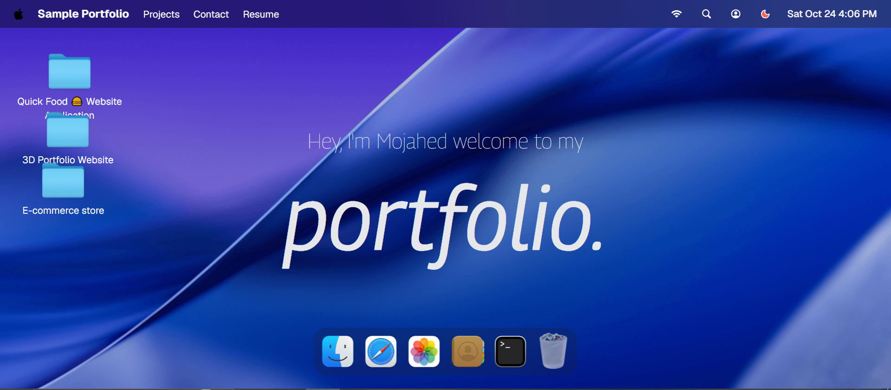

<div align="center">

# 🖥️ macOS Portfolio

**An interactive, macOS-inspired developer portfolio built with React 19 and GSAP.**

[](https://macos-portoflio-nu.vercel.app/)
[](https://react.dev/)
[](https://www.typescriptlang.org/)
[](https://tailwindcss.com/)
[](https://vite.dev/)

</div>

---



---

## ✨ Overview

This portfolio reimagines the classic macOS desktop experience entirely in the browser. Every "app" in the Dock opens as a real draggable, focusable window — complete with traffic-light controls, smooth GSAP animations, and a pixel-perfect macOS aesthetic.

It adapts seamlessly to mobile: on smaller screens the layout transforms into an iOS-style home screen with slide-up sheets and a bottom navigation bar.

---

## 🚀 Live Demo

👉 **[macos-portoflio-nu.vercel.app](https://macos-portoflio-nu.vercel.app/)**

---

## 🎯 Features

### 🖥️ Desktop Experience

| Feature                         | Description                                                                                                |
| ------------------------------- | ---------------------------------------------------------------------------------------------------------- |
| **Draggable Windows**           | Every app window can be freely dragged around the desktop using GSAP Draggable                             |
| **Window Focus & z-index**      | Clicking a window brings it to the front; z-index is managed globally via Zustand                          |
| **Traffic-Light Controls**      | Authentic red/yellow/green macOS window buttons to close windows                                           |
| **macOS-style Scale Animation** | Windows open with a scale-in spring animation (`power3.out`)                                               |
| **Animated Dock**               | Hover over the Dock to see icons magnify with a Gaussian falloff — just like the real macOS Dock           |
| **Variable-font Hero**          | The hero text reacts to your cursor, morphing letter weights in real-time using a GSAP variable-font trick |
| **macOS Menu Bar**              | A top navigation bar with wifi, search and profile icons                                                   |

### 📱 Mobile Experience

| Feature                   | Description                                                         |
| ------------------------- | ------------------------------------------------------------------- |
| **iOS Home Screen**       | A grid-based app launcher replicating an iPhone home screen         |
| **Slide-Up Sheets**       | Windows slide up from the bottom with an iOS-style spring animation |
| **Mobile Nav Bar**        | A persistent bottom navigation bar for quick app switching          |
| **Breadcrumb Navigation** | Deep Finder paths are navigable via a mobile breadcrumb trail       |

### 🪟 App Windows

| App                    | Content                                                                                                             |
| ---------------------- | ------------------------------------------------------------------------------------------------------------------- |
| **Portfolio (Finder)** | A macOS Finder clone with a sidebar and icon grid. Browse projects organized into folders (Work, About Me, Resume). |
| **Articles (Safari)**  | A Safari browser replica listing developer blog posts from jsmastery.com.                                           |
| **Gallery (Photos)**   | A macOS Photos app clone with categorized galleries (Library, Memories, Places, People, Favorites).                 |
| **Contact**            | Social links and email — GitHub, LinkedIn, Twitter, and more.                                                       |
| **Skills (Terminal)**  | A terminal-themed window listing the full tech stack, formatted like a shell command output.                        |
| **Resume (Pages)**     | An in-browser PDF viewer powered by `react-pdf` with page controls.                                                 |

---

## 🛠️ Tech Stack

```
Frontend     →  React 19, TypeScript 6
Styling      →  Tailwind CSS v4, tw-animate-css
Animation    →  GSAP 3 (Draggable, useGSAP)
State        →  Zustand 5 + Immer
Routing      →  React Router DOM v7
UI Lib       →  Base UI, shadcn/ui, Lucide React
PDF Viewer   →  react-pdf + pdfjs-dist
Responsive   →  react-responsive
Fonts        →  Geist Variable (@fontsource-variable/geist)
Build Tool   →  Vite 8 + Rolldown + React Compiler
Package Mgr  →  pnpm
Deployment   →  Vercel
```

---

## 📁 Project Structure

```
macos_portfolio/
├── public/
│   ├── icons/          # SVG icons (wifi, search, github, linkedin, …)
│   ├── images/         # App icons, project screenshots, gallery images
│   ├── files/          # Resume PDF
│   └── readme/         # README assets
├── src/
│   ├── components/
│   │   ├── Dock.tsx            # Animated macOS Dock
│   │   ├── Navbar.tsx          # macOS menu bar
│   │   ├── Welcome.tsx         # Hero section with variable-font effect
│   │   ├── Home.tsx            # Desktop background / wallpaper
│   │   ├── mobile/             # MobileHome, MobileNavBar, MobileClock, …
│   │   ├── window/             # WindowFrame (draggable wrapper) + WindowControls
│   │   └── ui/                 # shadcn button, dropdown-menu
│   ├── windows/
│   │   ├── Finder.tsx          # Portfolio / Finder window
│   │   ├── Safari.tsx          # Blog / Safari window
│   │   ├── Terminal.tsx        # Skills / Terminal window
│   │   ├── Resume.tsx          # PDF Resume viewer
│   │   ├── Contact.tsx         # Contact / Social links window
│   │   ├── Image.tsx           # Image app
│   │   └── ImageWindowViewer.tsx # Lightbox image viewer
│   ├── store/
│   │   ├── window.ts           # Zustand window state (open/close/focus/z-index)
│   │   ├── location.ts         # Finder sidebar location state
│   │   ├── gallery.ts          # Gallery navigation state
│   │   └── theme.ts            # Theme store
│   ├── hooks/
│   │   ├── useFinderDesktop.ts # Finder sidebar & item click logic (desktop)
│   │   └── useFinderMobile.ts  # Finder nav stack logic (mobile)
│   ├── constant/
│   │   └── index.ts            # All static data (nav, dock apps, projects, blog posts, tech stack, socials)
│   └── App.tsx                 # Root component
```

---

## ⚡ Getting Started

### Prerequisites

- [Node.js](https://nodejs.org/) ≥ 18
- [pnpm](https://pnpm.io/) ≥ 9

### Installation

```bash
# Clone the repository
git clone https://github.com/Mojahedhu/macos_portoflio.git
cd macos_portoflio

# Install dependencies
pnpm install

# Start the development server
pnpm dev
```

The app will be available at **`http://localhost:5173`**.

### Build for Production

```bash
pnpm build       # Type-check + Vite production build
pnpm preview     # Preview the production build locally
```

---

## 🎨 Customization

All portfolio content lives in a single file — [`src/constant/index.ts`](./src/constant/index.ts).

| Export             | What to edit                                      |
| ------------------ | ------------------------------------------------- |
| `dockApps`         | Add or rename Dock icons                          |
| `blogPosts`        | Add your own articles                             |
| `techStack`        | Update your skill categories                      |
| `socials`          | Change your social links                          |
| `locations` (Work) | Add, rename, or link your projects                |
| `ABOUT_LOCATION`   | Update bio text and personal photos               |
| `RESUME_LOCATION`  | Swap in your own PDF at `public/files/resume.pdf` |

---

## 🚢 Deployment

This project is pre-configured for **Vercel** — just connect your GitHub repo and it deploys automatically.

```bash
# Or deploy manually via Vercel CLI
pnpm build
vercel --prod
```

---

## 📄 License

This project is open-source and available under the [MIT License](./LICENSE).

---

<div align="center">

Made with ❤️ by **Mojahed** &nbsp;·&nbsp; [GitHub](https://github.com/Mojahedhu) &nbsp;·&nbsp; [LinkedIn](https://linkedin.com/in/mojahed-hussien)

<br/>

Thanks to **Javascript Mastery** for the tutorial

</div>
